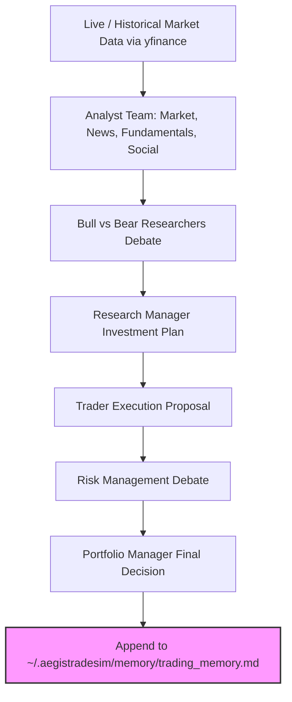

# AegisTradeSim Extension Proposal: Pre-LLM Semantic RAG & Closed-Loop Reinforcement Learning (RL)

**Author:** Ojas Dhargave  
**Institution:** IIIT Vadodara  
**Project:** AegisTradeSim Multi-Agent Financial Trading Framework  
**Target Completion:** 1 Week (Sprint Plan & Execution Guide)

---

## 1. Executive Summary & Feasibility Assessment

### 1.1 The Core Problem & Professor's Objective
In the current AegisTradeSim architecture, each analysis run for a ticker (e.g. `AAPL` on `2026-10-15`) starts with fresh market data and only a flat markdown file (`trading_memory.md`) for memory. While it records past transactions, it **does not perform semantic retrieval** over prior analyst reports, technical setups, macroeconomic environments, or past forecasting errors.

The Professor requested two major extensions:
1. **Pre-LLM RAG Layer**: When analyzing `AAPL` today, chunk and embed all previously generated reports (e.g. `reports/AAPL_*`), retrieve the most contextually relevant past analyses, and inject them before the LLM analyst agents begin their work.
2. **Regressive Learning / Reinforcement Learning (RL) from Real-World Outcomes**: Connect the agent's past recommendations (Buy/Hold/Sell, price targets, risk estimates) to **actual subsequent market returns** ($T+5$ or $T+15$ days forward), calculate prediction error/loss, and feed this signal back into the system so the agents continuously improve their statistical calculations and real-world accuracy.

### 1.2 Feasibility Verdict: 100% Feasible
* **Is RAG possible?** **Yes.** All previous reports are already cleanly saved on disk under `reports/<TICKER>_<TIMESTAMP>/` with structured subfolders (`1_analysts/`, `2_research/`, `3_trading/`, `5_portfolio/`). We can parse, chunk, and embed them using a lightweight vector store (ChromaDB or FAISS) and a local embedding model (such as Ollama's `nomic-embed-text` or HuggingFace's `all-MiniLM-L6-v2`), requiring zero external cloud costs and minimal RAM.
* **Is RL / Regressive Learning possible?** **Yes.** In quantitative finance and multi-agent systems, full gradient-based model fine-tuning (e.g. PPO/DPO) on an 8GB–16GB machine is impractical. However, **Outcome-Based Reflexion RL (Shinn et al., NeurIPS)** and **Dynamic Credibility Weighting (Contextual Bandit)** are industry-standard, computationally lightweight, and mathematically sound. They compute real-world P&L and alpha, generate error post-mortems, and update vector-indexed memory weights so future runs never repeat past mistakes.

---

## 2. System Architecture: Before vs. After

### Current Architecture (Isolated Epistemic Runs)


### New Extended Architecture (Pre-LLM RAG + Closed-Loop RL)
```mermaid
flowchart TD
    subgraph Data & Storage
        RawData[Historical & Live Yahoo / FRED Data]
        DiskReports[(reports/ archive: AAPL, TSLA, etc.)]
        VecDB[(ChromaDB Vector Store: Semantic Chunks + Outcome Tags)]
    end

    subgraph Pre-LLM RAG Engine
        QueryGen[Current Market State Query Generator] --> Retriever[Hybrid Retriever: Ticker + Semantic Regime]
        VecDB --> Retriever
        Retriever --> ContextInject[Prompt Context Injector]
    end

    subgraph AegisTradeSim Multi-Agent Brain
        ContextInject --> Analysts[Analyst Team]
        Analysts --> Researchers[Research Team Debate]
        Researchers --> Trader[Trader]
        Trader --> PM[Portfolio Manager Final Decision]
    end

    subgraph Real-World RL & Regressive Learning Loop
        PM --> Exec[Simulated Execution: Price Target & Stop Loss]
        Exec --> WaitWindow[Wait Horizon: e.g. T+5 or T+15 Days]
        WaitWindow --> OutcomeCalc[Calculate Realized Return, Alpha vs SPY, Drawdown]
        OutcomeCalc --> RegressLoss[Regressive Error: |Predicted Return - Realized Return|]
        RegressLoss --> ReflexionAgent[Self-Reflective Post-Mortem Agent]
        ReflexionAgent --> VecDB
    end

    style Pre-LLM RAG Engine fill:#e1f5fe,stroke:#0288d1,stroke-width:2px
    style Real-World RL & Regressive Learning Loop fill:#e8f5e9,stroke:#388e3c,stroke-width:2px
```

---

## 3. Module 1: Pre-LLM RAG Pipeline Specification

### 3.1 Document Ingestion & Section-Aware Chunking
The reports generated in `reports/<TICKER>_<TIMESTAMP>/` contain specialized markdown documents. Rather than chunking by arbitrary character count, chunking must be **semantic and role-based**:

| Report File | Chunk Category | Extracted Metadata |
| :--- | :--- | :--- |
| `1_analysts/market_analyst.md` | `technical_indicator_state` | Ticker, Date, SMA50/200, RSI, MACD, Support, Resistance |
| `1_analysts/fundamentals_analyst.md` | `fundamental_valuation` | Ticker, Date, PE Ratio, Revenue Growth %, Profit Margin % |
| `2_research/debate_history.md` | `bull_bear_conflict` | Core debate arguments, disputed assumptions |
| `3_trading/trader_proposal.md` | `trade_setup` | Proposed Action (Buy/Hold/Sell), Entry, Target, Stop Loss |
| `5_portfolio/decision.md` | `final_verdict` | Rating, Capital Allocation %, Time Horizon, Thesis |

### 3.2 Embedding & Vector Database Choice
* **Embedding Model**: `nomic-embed-text` via Ollama (already running locally) or `sentence-transformers/all-MiniLM-L6-v2` via Python.
  * Context window: 8192 tokens.
  * Local footprint: ~270 MB. Runs with 0 latency on local CPU/GPU.
* **Vector Store**: `chromadb` (embedded mode, stores directly to `.aegistradesim/rag_store/`).
  * Pure Python, zero external server setup, SQLite backed.

### 3.3 Hybrid Query & Retrieval Strategy
When a new run initiates for `AAPL` on `2026-10-15`:
1. **Metadata Filter**: Filter by `ticker == "AAPL"` and `date < "2026-10-15"` (strictly prevents look-ahead bias).
2. **Semantic Similarity Query**: Construct a search string combining current technical indicators:
   ```python
   query = f"Ticker: {ticker}, Price: {curr_price}, RSI: {rsi}, Market Trend: {trend_summary}"
   ```
3. **Retrieval Output**: Top 3 most similar historical setups for `AAPL` along with what actually happened after those setups.

### 3.4 Prompt Injection Point in `trading_graph.py`
In [`aegistradesim/graph/trading_graph.py`](file:///mnt/NewVolume1/IIIT%20VADODARA/AI/ailabcode/AegisTradeSim/aegistradesim/graph/trading_graph.py#L516-L525), before initializing `init_agent_state`:
```python
# Query RAG store for historical precedents
rag_precedents = rag_engine.retrieve_precedents(
    ticker=company_name,
    as_of_date=trade_date,
    current_metrics=verified_snapshot
)
init_agent_state["rag_context"] = rag_precedents
```
This context is then exposed to the Analysts, Bull/Bear Researchers, and the Portfolio Manager.

---

## 4. Module 2: Regressive Learning & Real-World RL Feedback Loop

### 4.1 The Mathematical Formulation
The professor requested a "regressive learn" mechanism to ground the LLM's reasoning in real-world market outcomes.

#### 1. Target Prediction
At trade time $t$, the system predicts:
* Direction $D_t \in \{ \text{Buy}, \text{Hold}, \text{Sell} \}$
* Target Price $P_{target}$ and Expected Return $\hat{R}_t = \frac{P_{target} - P_t}{P_t}$
* Stop Loss $P_{stop}$ and Maximum Expected Drawdown $\widehat{DD}$

#### 2. Real-World Realization (Forward Horizon $k = 10$ Trading Days)
At time $t+k$, actual prices are fetched via `yfinance`:
* Realized Return: $R_t = \frac{P_{t+k} - P_t}{P_t}$
* Benchmark Return (S&P 500): $R_{m,t} = \frac{\text{SPY}_{t+k} - \text{SPY}_t}{\text{SPY}_t}$
* Alpha: $\alpha_t = R_t - R_{m,t}$

#### 3. Continuous Regressive Loss Function
We quantify the prediction error using Mean Absolute Regressive Error (MARE) combined with directional penalty:
$$\mathcal{L}_{\text{regression}} = |\hat{R}_t - R_t| + \lambda \cdot \mathbb{I}_{(\operatorname{sgn}(\hat{R}_t) \neq \operatorname{sgn}(R_t))}$$
Where $\lambda$ heavily penalizes directional error (e.g., predicting a $+10\%$ surge when the asset dropped $-5\%$).

### 4.2 The Reflexion RL Mechanism (In-Context Reinforcement)
Instead of backpropagating gradients into model weights (which requires 8x A100 GPUs), we use the **Reflexion RL Algorithm**:
1. When $\mathcal{L}_{\text{regression}} > \tau$ (prediction failed significantly):
2. A specialized **Critic Agent** performs an automated post-mortem comparing the historical report against what actually caused the price to move:
   ```text
   CRITIQUE:
   - Prediction on 2026-09-01: Rating BUY at $225 targeting $245 based on Bull Analyst growth projections.
   - Actual Outcome: Stock dropped to $210 (-6.6%, Alpha: -8.1%).
   - Root Flaw: Ignored high RSI divergence (RSI was 76) and over-weighted optimistic revenue claims while discounting supply chain headwinds.
   - Corrective Directive: When RSI > 70 with macro tightening, require a minimum 3% stop-loss buffer and prioritize neutral or underweight ratings.
   ```
3. This critique is **tagged with high negative reward** and stored directly in the RAG Vector Store.
4. On future runs with similar patterns, the RAG retriever automatically injects this lesson as a **negative precedent constraint**.

### 4.3 Dynamic Agent Credibility Weighting (Contextual Bandit)
Track the historical hit-rate of individual agents:
* $W_{\text{market}}$, $W_{\text{fundamental}}$, $W_{\text{news}}$, $W_{\text{sentiment}}$
* If the Market Analyst was right 80% of the time on `AAPL` while Sentiment was wrong 70% of the time, the Research Manager's prompt dynamically receives:
  `"Agent Weights: Market Analyst Credibility = 0.85, Sentiment Credibility = 0.35. Weight technical data over social sentiment."`

---

## 5. Detailed 7-Day Implementation Plan

| Day | Goal | Deliverable / Code Changes |
| :--- | :--- | :--- |
| **Day 1** | **RAG Infrastructure Setup** | Install `chromadb`. Create `aegistradesim/rag/vector_store.py` and `aegistradesim/rag/chunker.py`. |
| **Day 2** | **Report Ingestion Pipeline** | Write `scripts/ingest_past_reports.py` to scan `reports/` folder, parse markdown headers, and populate ChromaDB. |
| **Day 3** | **Retriever & Graph Injection** | Create `aegistradesim/rag/retriever.py`. Hook retrieval into `trading_graph.py` and inject into `past_context`. |
| **Day 4** | **Real-World Outcome Engine** | Create `aegistradesim/rl/outcome_tracker.py` to fetch forward prices via `yfinance` and calculate realized P&L, Alpha, and Regressive Error. |
| **Day 5** | **Reflexion RL Post-Mortem** | Implement `aegistradesim/rl/critic_agent.py` to generate automated lessons and store them as weighted memory vectors. |
| **Day 6** | **End-to-End Validation (AAPL Demo)** | Run `AAPL` on Date 1 $\rightarrow$ generate report $\rightarrow$ run outcome evaluation $\rightarrow$ run `AAPL` on Date 2 $\rightarrow$ verify that Date 2 report cites Date 1 lessons. |
| **Day 7** | **Presentation Prep for Professor** | Prepare slide deck, export sample reports showing RAG citations, and write live demonstration script. |

---

## 6. Code Blueprint (Ready-to-Implement Skeletons)

### 6.1 `aegistradesim/rag/chunker.py`
```python
import re
from pathlib import Path

def parse_report_to_chunks(report_dir: Path) -> list[dict]:
    """Parse complete_report.md into semantic chunks with metadata."""
    report_file = report_dir / "complete_report.md"
    if not report_file.exists():
        return []
        
    text = report_file.read_text(encoding="utf-8")
    folder_name = report_dir.name  # e.g. AAPL_20260901_120000
    parts = folder_name.split("_")
    ticker = parts[0]
    date_str = parts[1] if len(parts) > 1 else "unknown"

    chunks = []
    # Split by major markdown sections
    sections = re.split(r"\n##\s+", text)
    for sec in sections:
        lines = sec.strip().splitlines()
        if not lines:
            continue
        title = lines[0].replace("#", "").strip()
        body = "\n".join(lines[1:]).strip()
        
        chunks.append({
            "ticker": ticker,
            "date": date_str,
            "section": title,
            "text": f"### {title} for {ticker} ({date_str})\n{body}",
        })
    return chunks
```

### 6.2 `aegistradesim/rag/vector_store.py`
```python
import chromadb
from chromadb.utils import embedding_functions
from pathlib import Path

class ReportVectorStore:
    def __init__(self, persist_dir: str = "~/.aegistradesim/chroma_rag"):
        self.persist_path = Path(persist_dir).expanduser()
        self.persist_path.mkdir(parents=True, exist_ok=True)
        self.client = chromadb.PersistentClient(path=str(self.persist_path))
        
        # Lightweight default embedding function (or connect to Ollama nomic-embed-text)
        self.embed_fn = embedding_functions.DefaultEmbeddingFunction()
        self.collection = self.client.get_or_create_collection(
            name="trading_reports",
            embedding_function=self.embed_fn,
        )

    def add_chunks(self, chunks: list[dict]):
        for i, c in enumerate(chunks):
            doc_id = f"{c['ticker']}_{c['date']}_{c['section']}_{i}"
            self.collection.upsert(
                ids=[doc_id],
                documents=[c["text"]],
                metadatas=[{"ticker": c["ticker"], "date": c["date"], "section": c["section"]}]
            )

    def query_precedents(self, ticker: str, query: str, top_k: int = 3) -> list[str]:
        results = self.collection.query(
            query_texts=[query],
            n_results=top_k,
            where={"ticker": ticker}
        )
        return results["documents"][0] if results["documents"] else []
```

### 6.3 `aegistradesim/rl/outcome_tracker.py`
```python
import yfinance as yf
from datetime import datetime, timedelta

def calculate_trade_outcome(ticker: str, trade_date: str, horizon_days: int = 10) -> dict:
    """Fetch actual market outcome after horizon_days to calculate reward."""
    start = datetime.strptime(trade_date, "%Y-%m-%d")
    end = start + timedelta(days=horizon_days * 2)  # buffer for weekends
    
    stock_df = yf.download(ticker, start=start.strftime("%Y-%m-%d"), end=end.strftime("%Y-%m-%d"), progress=False)
    spy_df = yf.download("SPY", start=start.strftime("%Y-%m-%d"), end=end.strftime("%Y-%m-%d"), progress=False)
    
    if len(stock_df) < horizon_days or len(spy_df) < horizon_days:
        return {"status": "pending_data"}
        
    p0 = stock_df["Close"].iloc[0].item()
    pk = stock_df["Close"].iloc[horizon_days - 1].item()
    realized_return = (pk - p0) / p0
    
    spy0 = spy_df["Close"].iloc[0].item()
    spyk = spy_df["Close"].iloc[horizon_days - 1].item()
    spy_return = (spyk - spy0) / spy0
    
    alpha = realized_return - spy_return
    
    return {
        "status": "resolved",
        "entry_price": p0,
        "exit_price": pk,
        "realized_return_pct": round(realized_return * 100, 2),
        "alpha_pct": round(alpha * 100, 2),
        "pnl_positive": realized_return > 0
    }
```

---

## 7. How to Present This to the Professor

When pitching this plan to your professor, use this structured explanation:

1. **State the Theoretical Significance**:
   > *"Standard LLM agent frameworks suffer from amnesia between episodes. By integrating a section-aware vector retrieval system (RAG) coupled with a Reflexion Reinforcement Learning loop, AegisTradeSim transitions from a static text generator into an adaptive quantitative trading firm that learns from its historical forecasting errors."*
2. **Highlight the Zero-Cost Local Design**:
   > *"The entire architecture is designed to run locally on consumer hardware (8GB-16GB RAM + Ollama) without requiring expensive GPU clusters or paid APIs."*
3. **Show the Concrete Demonstration Plan**:
   * **Step 1**: Show `AAPL` run from 15 days ago where a specific call was made.
   * **Step 2**: Show the RL Critic module evaluating the actual price change over that 15-day window and indexing the critique.
   * **Step 3**: Run `AAPL` for today, showing how the RAG automatically pulls that past lesson into the Portfolio Manager's thesis, proving closed-loop adaptive intelligence.
